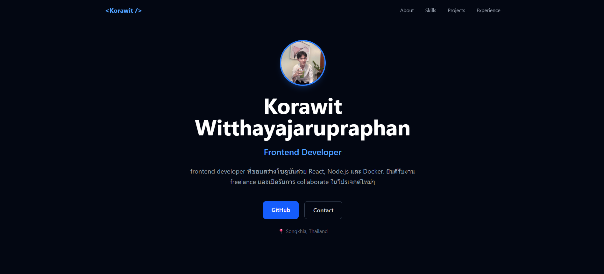

# 🐬 My Portfolio


> Personal Portfolio Website — Built with React, Express, Tailwind CSS & Docker

## 🚀 Tech Stack

| Layer | Technology |
|:---|:---|
| Frontend | React + Vite + Tailwind CSS |
| Backend | Node.js + Express |
| DevOps | Docker + Docker Compose |
| Version Control | Git + GitHub |

## 📁 Project Structure
my-portfolio/
├── client/              # React + Vite + Tailwind
│   ├── Dockerfile
│   ├── nginx.conf
│   └── src/
├── server/              # Node.js + Express
│   ├── Dockerfile
│   └── src/
├── docker-compose.yml   # Run everything
└── README.md

## 🛠️ Getting Started

### Prerequisites

- Node.js 20+
- Docker Desktop (with WSL 2 on Windows)

### Using Docker (Recommended)

```bash
docker compose up --build

Open: http://localhost:3000

# Terminal 1 — Backend
cd server
npm install
npm run dev

# Terminal 2 — Frontend
cd client
npm install
npm run dev
Open: http://localhost:3000

📡 API Endpoints
Method	Endpoint	Description
GET	/api/health	Server status
GET	/api/about	Personal info
GET	/api/skills	Skills list
GET	/api/projects	Projects list
GET	/api/projects/:id	Single project
GET	/api/experience	Work experience
